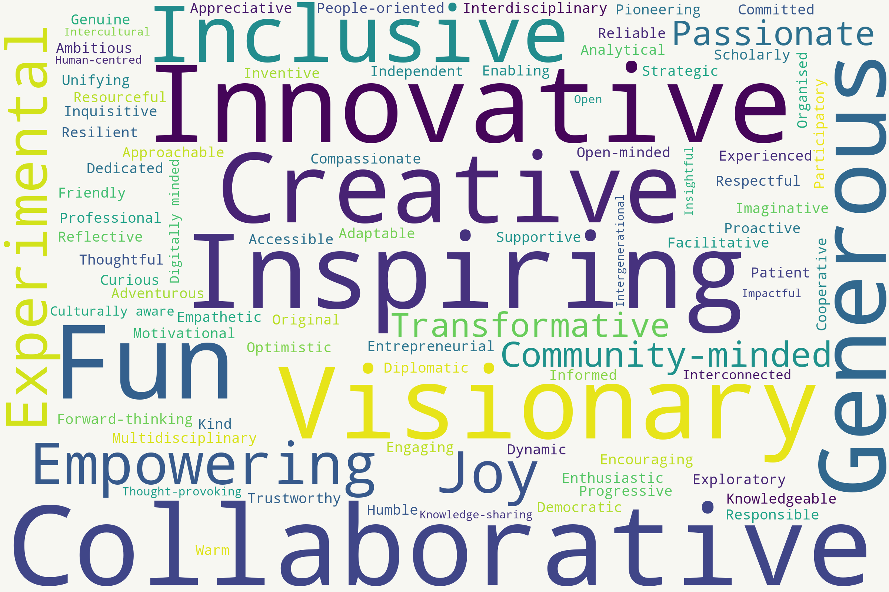

# wordcloud-Mahendra-Mahey

Adjective Selection and Methodology

The word cloud is built around a collection of descriptive adjectives that aim to capture Mahendra Mahey's professional identity, personality, contributions and approach to collaboration and innovation. The adjectives are inspired by his publicly visible professional work, particularly his contributions to digital cultural heritage, British Library Labs, GLAM Labs, community building, experimentation and knowledge sharing. The were automatically retrieved using a prompt.

For the visualisation, each adjective is assigned a frequency value that determines its relative size within the word cloud. Selected words, including Collaborative, Innovative, Inspiring, Visionary and Creative, are given higher weights to make them more prominent. These weights are creative design decisions intended to establish a visual hierarchy rather than quantitative measurements of Mahendra's personality or professional achievements.

The resulting word cloud transforms descriptive language into a visual representation of professional identity, highlighting themes of creativity, collaboration, openness, experimentation and community building.

